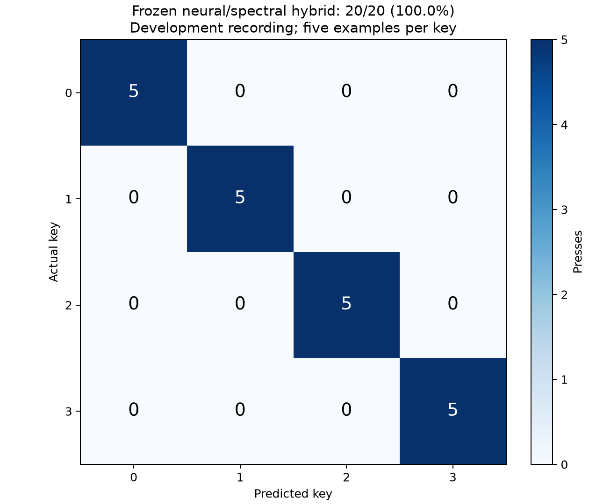
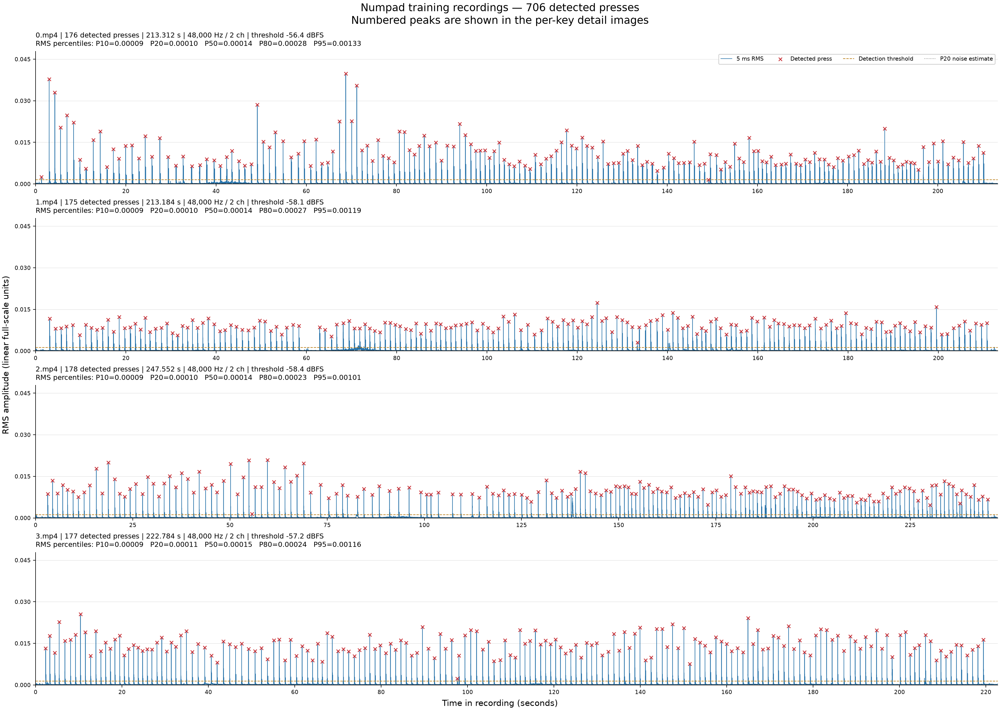

# Keypress SCA

**Can you tell which key someone pressed just by listening to it?**

I wanted to play around with that question, so I built a small acoustic side-channel experiment: record my keyboard, split the recordings into individual presses, train a classifier, and try it through a live microphone. This repository brings together the code, recordings, plots, and results from that process.

**There is no novelty claim here.** Acoustic keystroke recognition is an established research topic, and this is an exploratory project for learning and experimenting with existing approaches.

[Results and evidence](results/README.md) · [Dataset guide](datasets/README.md) · [Four-key pipeline](scripts/2_numpad/README.md) · [Method details](docs/methodology.md) · [Related work](docs/related-work.md)


## What I built

- A recording visualizer with RMS envelopes, detected peaks, noise estimates, and percentile summaries.
- A splitter that places boundaries in quiet gaps and preserves every decoded source sample across the exported clips.
- A ten-key experiment using MFCC features and conventional classifiers.
- A four-key experiment comparing a linear SVM, a large pretrained Swin ensemble, and a neural/spectral hybrid.
- File prediction, frozen-model evaluation, and live microphone prediction with timing and signal-quality diagnostics.
- Tests for segmentation, model persistence, training isolation, evaluation, and live/replay behavior.

The most useful lesson was that a much bigger model did not automatically work better. On the existing four-key recording, the SVM got **18/20**, the transformer ensemble got **15/20**, and the final hybrid got **20/20**. The hybrid combines learned spectrogram representations with explicit acoustic features.

## Results

These are small, previously observed benchmarks. In particular, the four-key recording was repeatedly used while improving the model, so its final score measures performance on a **development benchmark**. It does not establish 100% accuracy on fresh recordings or live typing.

| Experiment | Training clips | Evaluation | Correct | Accuracy |
| --- | ---: | --- | ---: | ---: |
| 1: ten keys, improved MFCC + LDA | 190 for evaluation; 251 for final fit | Later presses from the same source recordings | 50/51 | 98.04% |
| 1: ten keys, improved MFCC + LDA | 251 for final fit | Separate ten-press recording | 8/10 | 80.00% |
| 2: four keys, linear SVM | 706, all used for fitting | Existing twenty-press recording | 18/20 | 90.00% |
| 2: four keys, three Swin models | 706, all used for fitting | Same twenty-press recording | 15/20 | 75.00% |
| 2: four keys, final hybrid | 706, all used for fitting | Same twenty-press recording | 20/20 | 100.00% |

For experiment 1, the model used for the 51-clip chronological evaluation was fitted on 190 development clips. Its final deployment model was refitted on all 251 clips. Those are different fitting scopes; evaluating the final model on its training clips would not reproduce the held-out result.

The final four-key model also correctly recognized all **20 detected events** when the original sequence recording was replayed through the streaming detector at 48 kHz. Replay opens no microphone and uses the same already-observed recording. **Fresh live accuracy has not been established.**

See the [results index](results/README.md) for before/after comparisons, per-press predictions, report provenance, and the limits of each evaluation.



## Repository layout

```text
keypress-sca/
├── datasets/
│   ├── 1_numpad/          # Phone recordings: keys 0–9, 251 split clips
│   ├── 1_tests/           # Ten-press labelled sequence
│   ├── 2_numpad/          # USB microphone recordings: keys 0–3, 706 clips
│   ├── 2_tests/           # Twenty-press labelled sequence
│   └── audio_provenance.json
├── scripts/
│   ├── 1_numpad/          # Original ten-key pipeline and tests
│   └── 2_numpad/          # Four-key pipeline, hybrid model, and tests
├── results/               # Curated plots, JSON/CSV reports, and provenance
├── docs/                  # Methodology and reading list
└── work/                  # Local generated output; ignored by Git
```

The two numbered pipelines are kept separate to preserve their different datasets, feature settings, and training procedures. Runtime paths remain stable. `results/` is a saved evidence snapshot; running the pipeline writes new output under `work/`.

Source recordings and split audio are included. Generated model weights, checkpoints, caches, redundant ZIP archives, and scratch experiments are excluded. The newer source recordings are published as **audio-only M4A files**. Their AAC streams were copied from the local MP4 originals without re-encoding; decoded-audio equality is recorded in [audio provenance](datasets/audio_provenance.json). Historical result reports retain the original source filenames and hashes where appropriate.

## Quick start: run the lightweight four-key model

Run these commands from the repository root. Python **3.12** was used for the saved experiments. FFmpeg, ffprobe, and the LAME MP3 encoder are required; microphone capture also needs PortAudio.

On Ubuntu/Debian:

```bash
sudo apt-get update
sudo apt-get install ffmpeg libportaudio2
python3.12 -m venv .venv
source .venv/bin/activate
python -m pip install -r scripts/2_numpad/requirements-lock.txt
```

The lock file records the original environment. Direct dependency lists are also provided as `requirements.txt` files if you prefer to resolve an environment yourself.

The checkout includes the split clips, so you can train immediately. This fits a conventional SVM on all 706 clips and does not require PyTorch or a GPU:

```bash
python scripts/2_numpad/2_train.py --classic
python scripts/2_numpad/4_evaluate.py
python scripts/2_numpad/3_predict.py datasets/2_tests/02310231023102310231/1-0.mp3
```

Model weights are generated locally at `work/2_numpad/keypress_model.joblib`. Both classic and hybrid training write that default path, so use separate `--output-dir` directories and prediction/evaluation `--model` overrides if you want to retain several current models side by side.

## Train the full hybrid

The default four-key trainer combines **one Swin-B, two Swin-T models, and six spectral classifiers**. The neural models contain **141,792,184 parameters** in total. Each neural member trains for 80 epochs; all 706 original clips are used, with no internal test split. The spectral classifiers each fit on the original clips plus three augmented copies, giving **2,824 rows per head**.

The recorded run used an **RTX 5060 with 8 GB VRAM**, CUDA 12.8, PyTorch 2.9.1, and torchvision 0.24.1. For that CUDA setup, after installing the base requirements:

```bash
python -m pip install torch==2.9.1 torchvision==0.24.1 --index-url https://download.pytorch.org/whl/cu128
python -m pip install -r scripts/2_numpad/requirements-deep.txt
python scripts/2_numpad/2_train.py
python scripts/2_numpad/4_evaluate.py
```

Training downloads torchvision's ImageNet pretrained weights on first use. CPU execution is supported, but the full ensemble is expensive. Use the [official PyTorch installer](https://pytorch.org/get-started/locally/) for another platform, or the CPU wheel index in the [pipeline guide](scripts/2_numpad/README.md). The CUDA-specific `requirements-deep-lock.txt` records the full training environment.

Use `--neural-only` to train the transformer ensemble without the spectral heads, or `--classic` for the SVM. These are separate experiment modes; their measured results are listed above.

## Listen live

After training a model:

```bash
python scripts/2_numpad/5_live_predict.py
```

The default input is **LCS USB Audio Mono**. To choose your own microphone:

```bash
python scripts/2_numpad/5_live_predict.py --list-devices
python scripts/2_numpad/5_live_predict.py --device "YOUR MICROPHONE NAME"
```

Keep quiet during the initial background calibration, wait for `Ready`, then tap numpad keys **0, 1, 2, or 3** individually, at least 350 ms apart. The neural model is warmed before capture begins. Ctrl+C stops listening.

Output resembles this example; the values illustrate the fields:

```text
12:34:56.789: 2 (acc=n/a, conf=94.2%, top3=2:94.2%|1:4.1%|3:1.2%, snr=32.5dB, peak=-6.2dBFS, latency=501ms, infer=18.4ms, n=4, margin=3.134)
```

| Field | Meaning |
| --- | --- |
| Timestamp and key | Estimated impact time and predicted label |
| `acc` | Measured positional accuracy, available only with a known expected sequence |
| `conf` | Uncalibrated model confidence; classic SVMs report `n/a` |
| `top3` | Three ranked predictions, with probabilities or classifier scores |
| `snr`, `peak` | Estimated signal-to-noise ratio and peak audio level |
| `latency`, `infer` | Impact-to-output delay and inference time |
| `n`, `margin` | Detected-event count and separation between the best two scores |

To measure a fresh live attempt, type the supplied sequence in order:

```bash
python scripts/2_numpad/5_live_predict.py --expected-sequence 012301230123
```

The labels are used for scoring; the model predicts from audio. Missed or extra detections can shift positional alignment. Confidence is not measured accuracy and is not calibrated.

To replay the published recording through the streaming pipeline without opening a microphone:

```bash
python scripts/2_numpad/5_live_predict.py \
  --replay datasets/2_tests/02310231023102310231.m4a \
  --sample-rate 48000 \
  --expected-sequence 02310231023102310231
```

## Inspect and regenerate the clips

```bash
python scripts/2_numpad/0_visualize.py
python scripts/2_numpad/1_keypresses.py --dry-run
python scripts/2_numpad/1_keypresses.py --overwrite
```

The visualizer writes RMS/peak plots to `work/2_numpad/`. The splitter uses 5 ms RMS frames, groups related press/release transients, and requires quiet gaps before exporting. It refuses unsafe boundaries or mismatched labelled sequence counts. Exported clips collectively retain the decoded source samples, although MP3 encoding itself is lossy.

Training clips are named `<key>/<press>.mp3`. Sequence clips use `<sequence>/<press-number>-<actual-key>.mp3`: for example, `02310231023102310231/2-2.mp3`. The filename gives the labels; it is not a model prediction.



The [ten-key pipeline](scripts/1_numpad/README.md) follows the same numbered steps under `scripts/1_numpad/`, with its own data and model paths.

## How the model works

Audio is decoded to mono, a keypress is located, and a fixed window is aligned around its strongest impact. For the hybrid, this is a **320 ms window at 32 kHz**, with 80 ms before the peak. DC centering and peak normalization reduce level differences.

The neural branch converts the window into a **224 × 224 mel-spectrogram image** and averages the probabilities from three fine-tuned Swin Transformers. The acoustic branch measures three complementary views: overall log-mel statistics, temporal MFCCs, and a shorter attack-focused spectrum. Each view has a linear SVM and a shrinkage LDA classifier.

The final prediction combines **80% acoustic-head probabilities and 20% neural probabilities**. The fusion weight and feature design were chosen during experimentation with the existing benchmark. The pipeline uses audio features; expected test sequences are used only by evaluation and live scoring. It has no language model or text correction stage.

The [methodology](docs/methodology.md) describes preprocessing, augmentation, training settings, and evaluation scope in more detail.

## Limitations and what I learned

- **Keyboard specificity:** this prototype was trained on my keyboard. Transfer to another keyboard has not been established and would require new data or adaptation.
- **Small scope:** the current hybrid supports four keys, not a full keyboard. Other keys and unrelated transient sounds can still be assigned a supported label.
- **Recording confounds:** each key has one source training recording, so the model may learn recording conditions as well as the key sound.
- **Development reuse:** the twenty-press recording influenced improvements. Its perfect final score is useful for debugging, but a fresh session is needed to measure generalization.
- **Capture conditions:** microphone position, input gain, typing force, desk surface, and background noise can change the sound.
- **Slow isolated taps:** the 350 ms grouping and quiet-gap splitting were designed for deliberate presses. Fast, overlapping typing is outside the demonstrated setup.
- **Confidence:** a high probability can accompany an incorrect prediction. There is no trained unknown-key class or validated rejection policy.
- **Model size:** the large neural-only model performed worse than the simpler SVM on this benchmark. More parameters did not replace better data or suitable features.

A useful next experiment would collect several independently recorded sessions, randomize the order of keys, freeze a model before final testing, and measure confidence reliability and rejection of unfamiliar sounds. Those are possible follow-ups, not results achieved by this repository.

## Tests

```bash
python -m unittest discover -s scripts/1_numpad -p 'test_*.py' -v
python -m unittest discover -s scripts/2_numpad -p 'test_*.py' -v
```

Run each suite separately because the experiment folders contain modules with the same names. Tests use synthetic audio and temporary artifacts; they do not need a microphone or the full trained model. Neural tests run when optional PyTorch dependencies are installed.

## Prior work and acknowledgement

Acoustic keyboard inference predates this project by decades. Relevant examples include [Asonov and Agrawal (2004)](https://research.ibm.com/publications/keyboard-acoustic-emanations), [Zhuang et al. (2005)](https://people.eecs.berkeley.edu/~tygar/papers/Keyboard_Acoustic_Emanations_Revisited/preprint.pdf), [Harrison et al. (2023)](https://arxiv.org/abs/2308.01074), and [Ayati et al. (2025)](https://www.usenix.org/conference/woot25/presentation/ayati). The [reading list](docs/related-work.md) explains their relevance and includes later work on generalization.

This repository documents my own small implementation and experiments. Its scores use different data and evaluation conditions from those papers, so they should not be treated as a direct comparison or an advance over their results.

