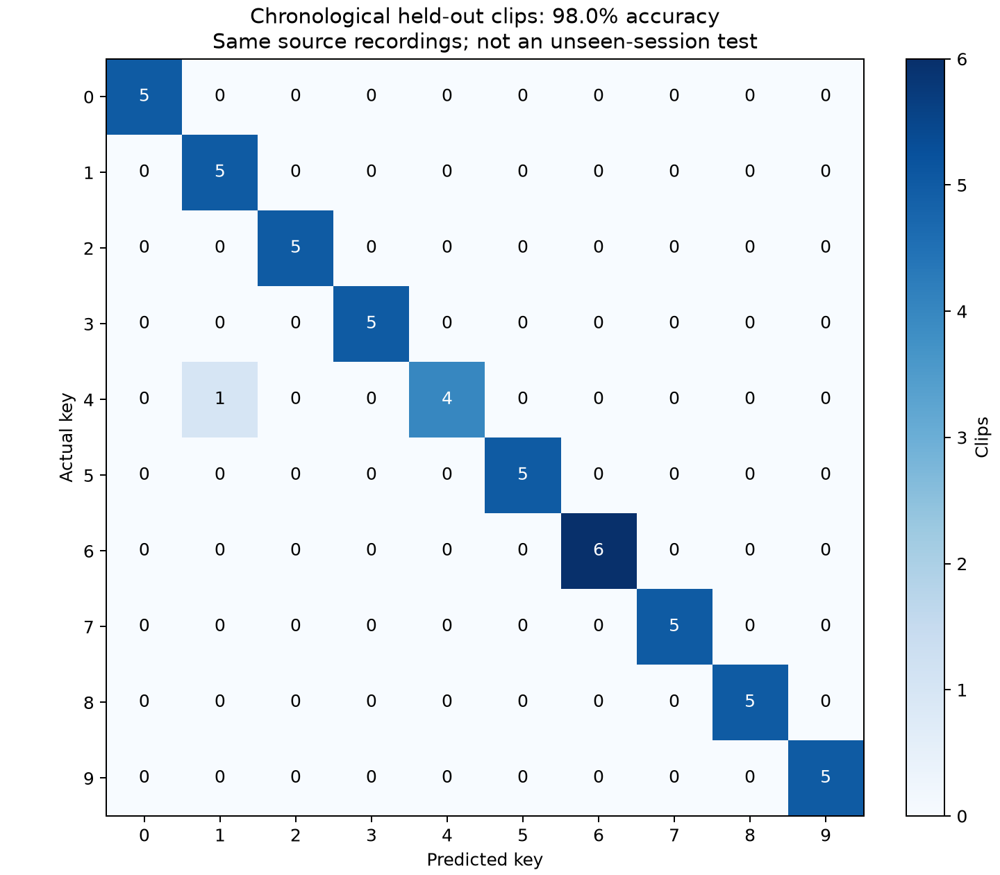

# Results and experiment notes

These are small exploratory experiments on recordings of one keyboard. I wanted to play around with acoustic keystroke recognition and build a working pipeline. There is no claim of a new attack, model architecture, or research contribution.

The committed files are snapshots of completed runs. New executions write into `work/`; they do not update these snapshots automatically. [provenance.json](provenance.json) records each original report or image, its SHA-256 hash, and the curated file's hash. JSON paths have been made repository-relative, CSV line endings use LF, and the older dataset-2 reports carry an explicit development-benchmark annotation. Measurements, predictions, and model hashes are preserved.

The historical dataset-2 reports refer to the original MP4 containers. The public dataset uses audio-only M4A containers extracted without re-encoding; the screen-video originals are excluded. [Audio provenance](../datasets/audio_provenance.json) maps the historical MP4 hashes to the public M4A hashes and verifies identical decoded audio. Historical MP4 paths and hashes should not be interpreted as hashes of the public M4A containers.

Redraw this overview from the committed reports with `.venv/bin/python results/render_overview.py`. This redraws the chart without training or evaluating a model.

## Experiment 1: phone recordings, ten numpad keys

The first dataset contains **251 training clips** of digits 0–9, recorded with a phone. Each key has 25 clips except key 6, which has 26. One separate recording contains the sequence `0789123456`, giving only one external example per key.

| Measurement | Original baseline | Improved weighted-MFCC + LDA model |
| --- | --- | --- |
| Repeated development validation | 509/570 (89.30%) | 568/570 (99.65%) |
| Later presses from the original recordings | 47/51 (92.16%) | 50/51 (98.04%) |
| Separate ten-press recording | 5/10 (50%) | 8/10 (80%) |
| Separate recording, correct key among top three | 9/10 (90%) | 10/10 (100%) |

The confusion matrix shows later presses from the original recordings, not a new recording session. The separate ten-press recording scored 8/10.

The development denominator is **570 predictions on 190 unique clips**, produced by repeating chronological validation with 3, 4, and 5 folds. It is not 570 independent recordings. The last 20% of each key's clips form the 51-clip chronological benchmark; clip 20 of each key is a boundary gap. The final prediction model is then fitted on all 251 clips, including that benchmark. Reproducing the chronological result requires the evaluation model fitted on the 190 development clips.

The separate recording's expected sequence is `0789123456`; the improved model predicts `0789113455`, confusing `2` with `1` and `6` with `5`. Both benchmarks had already been observed before the improvement run. They support an experiment comparison, rather than a fresh estimate of generalization. The training search used development clips only.

| Evidence | Contents |
| --- | --- |
| [model_comparison.json](1_numpad/model_comparison.json) | Before/after results, settings, counts, model hashes, remaining errors, and limitations |
| [evaluation.json](1_numpad/evaluation.json) | All 72 candidate results, chronological partitions, sample/source/code hashes, and library versions |
| [external_recording.json](1_numpad/external_recording.json) | Frozen-model evaluation of the ten-press recording |
| [external_predictions.csv](1_numpad/external_predictions.csv) | Actual keys, predictions, and top-three rankings |
| [heldout_predictions.csv](1_numpad/heldout_predictions.csv) | Predictions for the 51 chronological benchmark clips |
| [RMS/peak visualization](1_numpad/rms_peaks.png) | Detection peaks, thresholds, and RMS percentiles for all ten recordings |
| [Chronological confusion matrix](1_numpad/confusion_matrix.png) | Errors on later presses from the same source recordings |

## Experiment 2: USB microphone, four numpad keys

The second dataset contains **706 clips** of digits 0–3, recorded using the same LCS USB microphone setup used for live prediction. The original 48 kHz MP4 audio has two identical channels. Training uses 176 clips of `0`, 175 of `1`, 178 of `2`, and 177 of `3`.

Every model below uses all 706 clips for fitting, with **no internal validation or test split**. The comparison recording contains 20 presses: `02310231023102310231`, five examples per key.

| Model | Top-one result on the same 20-press recording | Interpretation |
| --- | --- | --- |
| Weighted MFCC + linear SVM baseline | 18/20 (90%) | Two `3` presses predicted as `2` |
| Three pretrained Swin models | 15/20 (75%) | The much larger neural model regressed |
| Final neural/spectral hybrid | 20/20 (100%) | Best result on the reused development recording |
| Final hybrid, streaming replay at 48 kHz | 20/20 (100%) | Twenty complete detected events, no rejected candidates; no microphone opened |

**The 20-press recording guided feature and model development.** Its clips were not supplied as fitting examples, but its results influenced design choices. It is therefore a development benchmark, and the 100% result is not an independent test or a measured fresh-live accuracy. Replaying the same recording through the streaming detector is a pipeline check, not another independent dataset.

The final confusion matrix covers the existing twenty development presses. Fresh live accuracy remains unmeasured.

The final hybrid averages six acoustic experts and three Swin models with weights **80% spectral / 20% neural**. The neural component contains **141,792,184 parameters**: one Swin-B and two Swin-T models, trained for 80 epochs each. Each acoustic head fits 706 original clips plus three augmented versions per clip, or 2,824 rows per head. These augmented rows are not additional independently recorded examples.

These curves measure fit to augmented training examples. There is no validation curve or independent test accuracy in this figure.

| Evidence | Contents |
| --- | --- |
| [summary.json](2_numpad/summary.json) | Final result, comparison scores, per-key counts, confusion matrix, and the fresh-live-accuracy limitation |
| [training.json](2_numpad/training.json) | Model configuration, full-data fit, seeds, augmentation, hashes, and development-benchmark disclosure |
| [training_history.json](2_numpad/training_history.json) | Per-epoch augmented-training loss and accuracy for each Swin member |
| [baseline_evaluation.json](2_numpad/baseline_evaluation.json) | 18/20 baseline predictions and source/model fingerprints |
| [neural_evaluation.json](2_numpad/neural_evaluation.json) | 15/20 standalone-neural predictions and fingerprints |
| [hybrid_evaluation.json](2_numpad/hybrid_evaluation.json) | 20/20 final-hybrid predictions and fingerprints |
| [hybrid_predictions.csv](2_numpad/hybrid_predictions.csv) | Per-press labels, predictions, scores, and clip hashes |
| [streaming_replay.jsonl](2_numpad/streaming_replay.jsonl) | Native-rate replay events, signal measurements, confidence, and timing |
| [Training-recording RMS peaks](2_numpad/rms_peaks.png) | Peaks, thresholds, and RMS summaries for the four training recordings |
| [Development-recording RMS peaks](2_numpad/test_rms_peaks.png) | Detected peaks in the twenty-press comparison recording |
| [Training curves](2_numpad/training_curves.png) | Augmented-training metrics, with no validation curve |
| [Development confusion matrix](2_numpad/test_confusion_matrix.png) | Five correct predictions per key on the development recording |

## What these results establish

The experiments demonstrate recording inspection, conservative splitting, audio classification, model comparison, and a functioning streaming detector on these recordings. They also show that a larger pretrained model can perform worse than a small spectral classifier when data are limited.

The current recognizers are restricted to the trained keyboard and supported keys. Cross-keyboard transfer was not evaluated. Each key has only one training source recording, so recording-specific conditions can be confused with key identity. Generalization across sessions, typists, microphone positions, background noise, and rapid typing remains unmeasured. Output probabilities are uncalibrated confidence, not accuracy; unknown keys and unrelated transient sounds have no learned rejection class.

A useful next evaluation would collect several new sessions with all supported keys interleaved, freeze the model before inspecting the final sessions, and measure detection errors as well as classification accuracy. The suggested calibration/selective-prediction study remains a possible future experiment; it has not been implemented or validated here.

See the [project README](../README.md) for setup and the [pipeline guides](../scripts/README.md) for reproduction commands. Trained model binaries and intermediate caches are local generated artifacts; the public reports record their identities without requiring those binaries to browse the results.
