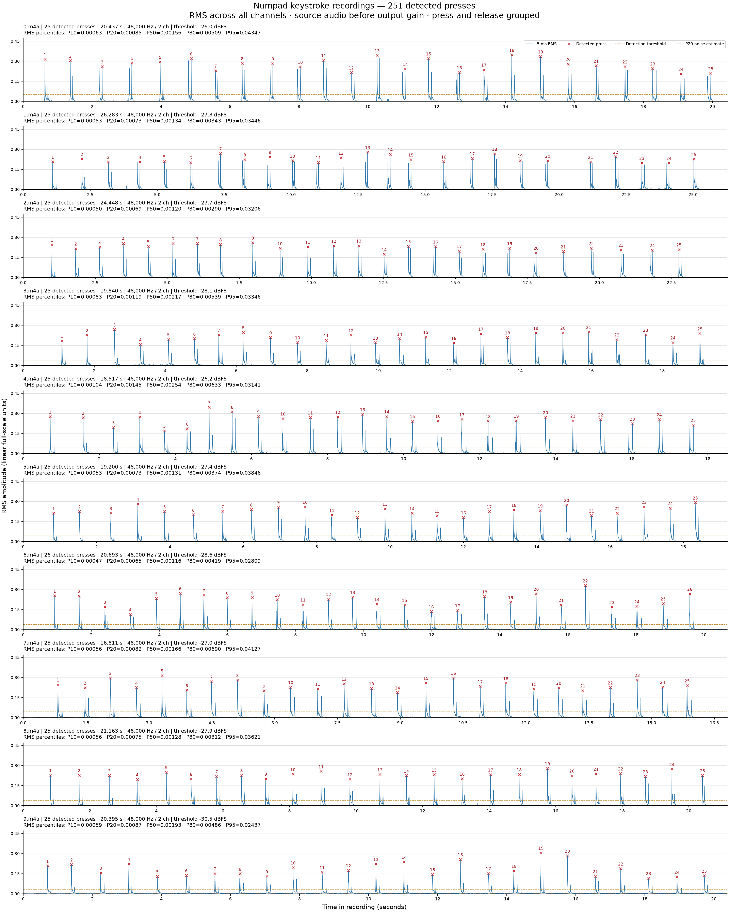

# Dataset 1: phone recordings of numpad keys 0–9

This is the first experiment: 251 training clips across ten numpad keys, recorded on a phone, with a separate ten-press sequence. It uses MFCC features and classic classifiers. I built it to play around with acoustic keystroke recognition; there is no novelty claim. [Dataset 2](../2_numpad/README.md) contains the later four-key microphone experiment.

## Setup and quick start

Install FFmpeg (including `ffprobe` and the `libmp3lame` encoder), Python 3.12, and PortAudio for microphone capture. From the repository root:

```bash
python -m venv .venv
source .venv/bin/activate
python -m pip install -r scripts/1_numpad/requirements-lock.txt
```

Python 3.12 was used for the recorded experiments. `requirements-lock.txt` records exact dependency versions; `requirements.txt` lists direct dependencies. **Model weights are not included in Git.** Train locally before predicting or evaluating. New plots, models, and reports are written to the ignored `work/1_numpad/` directory; selected historical evidence is published under [`results/`](../../results/README.md).

From the repository root, with the environment active:

```bash
python scripts/1_numpad/0_visualize.py
python scripts/1_numpad/1_keypresses.py --dry-run
python scripts/1_numpad/2_train.py
python scripts/1_numpad/4_evaluate.py
python scripts/1_numpad/3_predict.py datasets/1_tests/0789123456/1-0.mp3
python scripts/1_numpad/5_live_predict.py
```

Prepared split clips are included. The dry run checks them against the source recordings without rewriting files. To regenerate clips, use the splitter with `--overwrite` as described below. A replay can be used instead of microphone capture.

## Visualize recordings

`0_visualize.py` saves `work/1_numpad/rms_peaks.png`: one RMS envelope per key, numbered detected presses, detection threshold and P20 noise estimate lines, and P10/P20/P50/P80/P95 RMS percentile summaries. All ten plots share a linear amplitude scale. Analysis uses the original recordings before the splitter's output gain.

The visualizer shares the splitter's detector and remains usable when a recording has an unexpected count or no safe split gaps. This makes it useful for inspecting detection settings before splitting. Both scripts accept `--threshold-db` to override the adaptive detection threshold.

Paths default to the repository's dataset and work directories, regardless of the current working directory. Use `--dataset-dir PATH`, `--output PATH.png`, or `--dpi 240` to change the input, image location, or resolution. Re-running the visualizer replaces its output image.



The saved overview shows the 251 retained detections, with 26 for key 6 and 25 for each other key. Peak counts and quiet-gap checks help inspect segmentation; they do not measure classification accuracy.

## Split recordings

By default the script processes both training recordings and any test recordings. It reads `datasets/1_numpad/0.m4a` through `9.m4a` and writes numbered training clips such as `datasets/1_numpad/0/1.mp3`. Use `--dataset-dir PATH` for a different training directory, `--only training` to process just training recordings, or `--overwrite` to regenerate existing clips. Overwriting also removes obsolete generated MP3s in the selected output folders.

```bash
python scripts/1_numpad/1_keypresses.py --overwrite
```

To split new test recordings without rewriting existing training clips:

```bash
python scripts/1_numpad/1_keypresses.py --only tests
```

Test recordings are read from `datasets/1_tests/` (override with `--tests-dir PATH`). Each M4A filename must spell the key sequence in press order. Clips use `NUMBER_OF_PRESS-ACTUAL_NUMBER_PRESSED.mp3`, with press numbering starting at 1. For example, `0789123456.m4a` must contain exactly ten presses; it produces `datasets/1_tests/0789123456/1-0.mp3`, `2-7.mp3`, `3-8.mp3`, and so on through `10-6.mp3`. Repeated keys keep their global press position: `0070.m4a` produces `1-0.mp3`, `2-0.mp3`, `3-7.mp3`, `4-0.mp3`. Regenerate with `--only tests --overwrite` to replace previous exports and remove obsolete filenames from the former key-occurrence format.

Test labels come from the filename, and detection must match the exact sequence length before any files are exported. No labels are inferred by the classifier during splitting. `--expected-counts` applies only to training recordings. Test boundaries, keys, and press order are recorded in `datasets/1_tests/split_manifest.json`. Training and test directories use separate gain calculations, so a new test recording cannot alter training audio levels. Default paths work from any working directory.

## How it avoids cutting keystrokes

- Detects transients using 5 ms RMS energy across both channels, with a threshold estimated separately for each recording.
- Groups the press and release transients using a 350 ms minimum interval between detected presses. These recordings contain slow, separated presses; this setting is unsuitable for rapid typing.
- Places each cut inside a quiet window of at least 50 ms, at least 200 ms after the preceding press peak and 100 ms before the next. It refuses to export if no safe gap exists.
- Retains every decoded sample, including leading/trailing quiet and the silence between presses. Clips therefore have variable durations. No onset, release, or decay is trimmed away; no denoising, fades, channel mixing, or resampling are applied to the exported audio.
- Validates that each training recording contains 25 or 26 detections and each test recording matches its filename length before writing anything. It never forces a recording to have that count. If inspection justifies another training count, use `--expected-counts`; `--threshold-db` overrides detection sensitivity.

MP3 uses the original sample rate and channel count with LAME's highest VBR quality (`-q:a 0`). MP3 is lossy; retain the original M4As for research. A single shared gain across all recordings leaves encoding headroom when decoded AAC peaks exceed full scale, preserving relative amplitudes between keys and clips.

All clips are encoded in a temporary directory before installation. Original recordings are never changed. `datasets/1_numpad/split_manifest.json` records source hashes, thresholds, the shared gain, and the exact source sample boundaries of every clip.

For the supplied recordings, detection finds **25 presses per key except 6, which has 26: 251 clips total**. Automatic counts and quiet boundaries are safeguards; listen to representative outputs before using the dataset for training.

## Train the classifier

```bash
python scripts/1_numpad/2_train.py
```

`2_train.py` reads the numbered MP3s in `datasets/1_numpad/0/` through `9/`. Folder names are the class labels. It runs a fixed search of **72 configurations**: six feature profiles, each compared with RBF SVM, linear SVM, and shrinkage linear discriminant analysis (LDA) settings. The selected model in the recorded run uses **80 energy-weighted MFCC features and LDA with automatic covariance shrinkage**. Historical baseline metrics are retained in the [curated results](../../results/README.md).

Training and prediction share the same preprocessing in `keypress_model.py`: decode to mono at 24 kHz, identify one isolated press, and align a 320 ms window beginning 40 ms before the strongest 5 ms RMS frame. Short context is padded. The window is DC-centered and peak-normalized, then converted to a 64-band mel spectrogram using a 512-sample Hann window and 128-sample hop. The selected representation contains weighted temporal means and standard deviations of 40 MFCCs. Frame weights are proportional to the square root of summed mel power and normalized to sum to one. Quiet background frames therefore contribute less than the press/release sounds, improving on the original uniform averaging. Clip length and long leading silence are not input features.

Feature scaling is fitted inside each classifier pipeline. Model selection uses only the first 19 presses per key: **190 development clips**. Validation repeats three chronological partitions with 3, 4, and 5 folds, excluding the immediately neighboring press on either side of each validation block from training. This gives 12 folds and **570 predictions on the same 190 clips**, rather than 570 independent samples. Selection ranks pooled validation accuracy, then worst-fold accuracy, then feature count and model simplicity. Full settings and tie rules are recorded in `evaluation.json`.

Clip 20 from each key is excluded as a boundary gap. The last 20% of each key's clips (21 onward: **51 clips**) are evaluated after model selection. The final model is then refitted on all 251 clips. Test recordings in `datasets/1_tests/` are never read by the training script or used to choose features/settings.

Results for the supplied dataset:

| Measure | Original model | Improved model |
| --- | --- | --- |
| Repeated development validation, same partitions | 509/570 (89.30%) | 568/570 (99.65%) |
| Chronological benchmark within source recordings | 47/51 (92.16%) | 50/51 (98.04%) |
| Separate `0789123456` recording | 5/10 (50%) | 8/10 (80%) |
| Separate recording, top three choices | 9/10 (90%) | 10/10 (100%) |

The expected external sequence is `0789123456`; the improved model predicts `0789113455`, confusing `2` with `1` and `6` with `5`. Both benchmark sets had already been observed before this improvement run; these are comparison results on existing benchmarks, rather than fresh untouched tests. All new model selection used development clips only.


This matrix shows **50/51 correct** on later presses from the same source recordings, using the model fitted on 190 development clips. It does not describe the separate recording's **8/10** result or fresh-session performance.

Each training key currently has one source recording, so recording conditions and key labels are confounded. The separate test recording has just one example per key. Collect several sessions containing all ten keys and reserve complete sessions for a stronger generalization assessment, including any new phone, microphone position, or keyboard. The evaluation design follows scikit-learn's guidance on [preprocessing leakage](https://scikit-learn.org/stable/common_pitfalls.html) and [correlated observations in validation](https://scikit-learn.org/stable/modules/cross_validation.html).

Training writes the following files to `work/1_numpad/`:

| File | Purpose |
| --- | --- |
| `keypress_model.joblib` | Model for new predictions, refitted on all 251 clips after evaluation |
| `evaluation_model.joblib` | Model fitted on 190 development clips, for reproducing the held-out results |
| `evaluation.json` | All 72 candidate results, repeated validation folds, metrics, source/clip/code hashes, settings, seeds, and library versions |
| `heldout_predictions.csv` | Actual and predicted keys, plus top-three ranking scores for each reserved clip |
| `confusion_matrix.png` | Actual versus predicted key counts on the 51 reserved clips |

The final model includes the former holdout clips in its training set. To reproduce the reported evaluation, use `evaluation_model.joblib`. Re-running training replaces these five artifacts. `--dataset-dir PATH` and `--output-dir PATH` override the defaults, which otherwise work from any working directory.

Local historical runs may exist under `work/1_numpad/runs/`; they are excluded from Git. The public [results directory](../../results/README.md) contains the selected comparison evidence and figures.

## Predict a key from audio

```bash
python scripts/1_numpad/3_predict.py path/to/new_keypress.m4a
python scripts/1_numpad/3_predict.py path/to/new_keypress.wav --json
```

The input must contain one isolated keypress, including its release. MP3, M4A, WAV, and other FFmpeg-readable formats are supported; input sample rate and duration may differ from the training clips. The command prints the predicted key and the top three ranked classifier scores. These scores are not probabilities. Use `--top-k 1` for only the highest-ranked key, or `--model PATH` to load a different trained artifact.

Silence, stationary background noise, invalid audio, and multiple well-separated presses are rejected. The transient check groups press/release sounds within 350 ms, matching these slow recordings; it is not a rapid-typing segmenter. The classifier chooses among `0` through `9` only and has no learned class for other keys or unrelated transient sounds.

## Evaluate split test recordings

```bash
python scripts/1_numpad/4_evaluate.py
python scripts/1_numpad/4_evaluate.py --model work/1_numpad/runs/baseline/keypress_model.joblib
```

`4_evaluate.py` evaluates a frozen model against `datasets/1_tests/<sequence>/<press>-<actual>.mp3`, sorting press numbers numerically and checking labels against the source sequence and splitter manifest. It never trains or changes the model. `--tests-dir PATH`, `--model PATH`, and `--output-dir PATH` override the defaults.

Per-recording and overall JSON/CSV reports are saved under `work/1_numpad/test_results/model-<model-hash>/data-<data-hash>/`. Different models and datasets keep separate reports. `work/1_numpad/test_results/latest.json` contains the most recent evaluation and its report directory. The reports include top-three choices, model/source/clip hashes, and the number of samples used to fit the model.

## Listen through the microphone

```bash
python scripts/1_numpad/5_live_predict.py
```

The default input is **LCS USB Audio Mono**, selected by name so changing device IDs do not change the intended microphone. The script uses channel 1 at the device's supported native sample rate (48 kHz for the connected LCS input), then resamples each completed event for the model. Keep quiet for the initial 1.5-second background calibration and use individual numpad taps at least 350 ms apart. Press **Ctrl+C** to stop; `--duration 30` stops after 30 seconds.

Output has this form; the values below illustrate the fields:

```text
12:34:56.789: 7 (acc=n/a, conf=99.2%, top3=7:99.2%|1:0.6%|8:0.2%, snr=32.5dB, peak=-6.2dBFS, latency=501ms, infer=2.4ms, n=4, margin=1.234)
```

`conf` is the classifier's **uncalibrated probability estimate**, not measured accuracy. It can be very high for an incorrect prediction. Older models without probability support show `conf=n/a` and raw ranking scores. This distinction follows scikit-learn's [probability-calibration guidance](https://scikit-learn.org/stable/modules/calibration.html).

For measured accuracy, provide a known sequence and type it in order:

```bash
python scripts/1_numpad/5_live_predict.py --expected-sequence 0789123456
```

`acc` then compares each detected event with the corresponding expected key, and adds `actual` and `hits` fields. Rejected and extra detections count as errors; the final summary also penalizes missing expected presses. This is positional sequence scoring: a missed/extra detection can shift subsequent comparisons. Expected labels are supplied through this option; predictions use audio only. Without known labels, `acc=n/a` is the honest result.

The remaining fields help assess capture quality:

| Field | Meaning |
| --- | --- |
| Time | Key-impact time; live wall clock defaults to Australia/Melbourne |
| `top3` | Three ranked keys with model probabilities, or raw scores when unavailable |
| `snr` | Estimated strongest 5 ms RMS level relative to the background noise estimate |
| `peak` | Event peak amplitude in dBFS |
| `latency` | Key-impact-to-output delay, including capture context and inference |
| `infer` | Feature extraction and classification time |
| `n` | Detected-event index, including rejected candidates |
| `margin` | Gap between the two highest classifier decision scores |
| `quality` | Flags identifying ambiguous, overlapping, or truncated captures |

Useful commands:

```bash
python scripts/1_numpad/5_live_predict.py --list-devices
python scripts/1_numpad/5_live_predict.py --device "LCS USB Audio Mono"
python scripts/1_numpad/5_live_predict.py --replay datasets/1_tests/0789123456.m4a --expected-sequence 0789123456
python scripts/1_numpad/5_live_predict.py --replay datasets/1_tests/0789123456.m4a --sample-rate 48000 --json
```

Replay uses the same streaming detector and predictor, with elapsed recording timestamps and audio-time buffering latency. It does not open a microphone. `--json` emits one JSON record per event; startup and summary messages go to stderr. `--time-format wall|elapsed` and `--timezone UTC` control timestamps.

`--threshold-db -35` sets an explicit trigger in dBFS; choose it above the measured noise level. Otherwise the trigger adapts to background noise and recent event levels, recovering after sustained ambient-noise changes. A fixed threshold below persistent background noise stops capture with a diagnostic. `--trigger-db` changes the noise-relative threshold; a recent loud sound can impose a higher reference floor, so use the fixed threshold override when troubleshooting that case. Events without safe, complete context are printed as `?` with quality flags rather than assigned a clean prediction. Audio overflow or a failed callback stops capture explicitly, because dropped audio invalidates timing and expected-sequence alignment.

Microphone capture requires `sounddevice` and PortAudio. The Python dependency is included in both requirements files. Device discovery and recording use the documented [sounddevice stream API](https://python-sounddevice.readthedocs.io/en/latest/api/streams.html). The model was trained on phone recordings; a different microphone or position can change recognition performance.

## Verify the pipeline

```bash
python -m unittest discover -s scripts/1_numpad -p 'test_*.py' -v
```

The tests cover safe segmentation, sequence labels, overwrite behavior, repeated chronological split isolation, candidate selection, numeric ordering, feature dimensions, background/gain/leading-silence robustness, invalid inputs, decoding parity, classifier persistence, frozen-model evaluation, streaming event timing/context, confidence versus measured accuracy, replay isolation, and microphone error cleanup.
