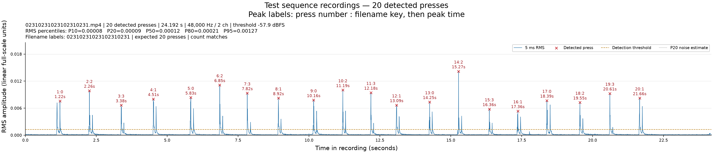
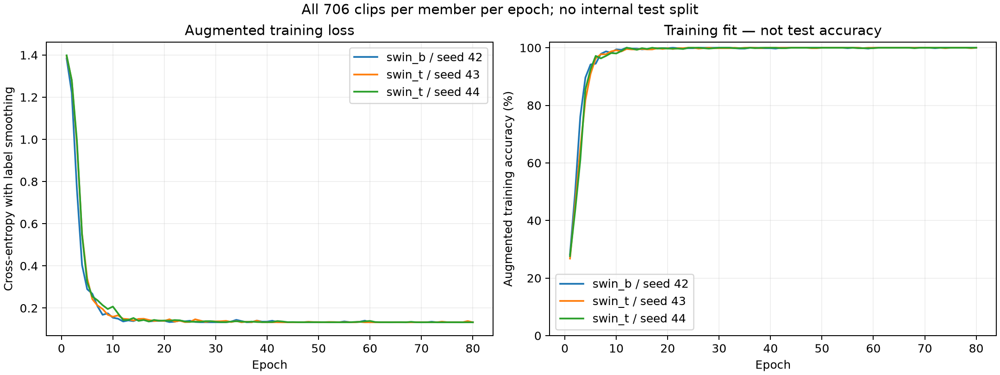

# Dataset 2: numpad keys 0–3

This is the later experiment, using the recordings in `datasets/2_numpad` and the sequence recording in `datasets/2_tests`. Its model recognizes **0, 1, 2, and 3**. The first ten-key phone experiment remains under [`scripts/1_numpad/`](../1_numpad/README.md).

I wanted to play around with acoustic keystroke recognition and compare approaches. This is an exploratory implementation, with no claim of a new attack or method. The default model combines a **141,792,184-parameter Swin Transformer ensemble** with **six acoustic classifiers**. A small classic SVM remains available for a lower-resource starting point.

## Setup

Install FFmpeg and ffprobe, Python 3.12, and PortAudio for microphone capture. From the repository root:

```bash
python -m venv .venv
source .venv/bin/activate
python -m pip install -r scripts/2_numpad/requirements-lock.txt
```

**Model weights are not included in Git.** Train locally before file prediction, evaluation, or live prediction. Scripts save new outputs under the ignored `work/2_numpad/` directory. Selected historical metrics and plots are published under [`results/`](../../results/README.md).

For default hybrid or standalone neural training and inference, install PyTorch and torchvision as well. This CUDA 12.8 setup was verified on an **RTX 5060 with 8 GB VRAM**, with Python 3.12, PyTorch 2.9.1, and torchvision 0.24.1:

```bash
python -m pip install torch==2.9.1 torchvision==0.24.1 --index-url https://download.pytorch.org/whl/cu128
python -m pip install -r scripts/2_numpad/requirements-deep.txt
```

The CUDA wheels include their runtime libraries. For a CPU environment, use the official `https://download.pytorch.org/whl/cpu` index instead. `requirements-deep.txt` is optional when using only the classic SVM. See the [PyTorch installation guide](https://pytorch.org/get-started/locally/) for other platforms. `requirements-deep-lock.txt` records the complete verified CUDA environment; it is platform-specific.

## Run the pipeline

From the repository root:

```bash
python scripts/2_numpad/0_visualize.py
python scripts/2_numpad/1_keypresses.py --dry-run
python scripts/2_numpad/2_train.py
python scripts/2_numpad/4_evaluate.py
python scripts/2_numpad/3_predict.py datasets/2_tests/02310231023102310231/1-0.mp3
```

Prepared split clips are included, so the splitter dry run is sufficient before training. Existing split outputs require `--overwrite` to regenerate. Use `--only training` or `--only tests` with the splitter to select one group. Default paths are resolved from the script location, so commands also work from another working directory.

To start with the classic model using only the base dependencies:

```bash
python scripts/2_numpad/2_train.py --classic
python scripts/2_numpad/4_evaluate.py
python scripts/2_numpad/5_live_predict.py
```

Both modes use `work/2_numpad/keypress_model.joblib` by default. To keep separate models, train with `--output-dir work/2_numpad/classic` and pass `--model work/2_numpad/classic/keypress_model.joblib` to prediction, evaluation, and live commands.

## Sources and segmentation

The published sources are audio-only M4A files. The original recordings used MP4 containers with screen video; they were remuxed without re-encoding the audio, and the private video originals remain local. [`datasets/audio_provenance.json`](../../datasets/audio_provenance.json) records old and new source hashes and matching decoded-audio hashes. Historical reports retain their original MP4 source names and file hashes; these are not the hashes of the published M4A containers.

Training sources are single-digit files for keys 0–3. The decoder uses the first audio stream. MP4, M4A, and WAV sources are supported, and duplicate formats for the same label are rejected.

| Source | Detected training events |
| --- | ---: |
| `datasets/2_numpad/0.m4a` | 176 |
| `datasets/2_numpad/1.m4a` | 175 |
| `datasets/2_numpad/2.m4a` | 178 |
| `datasets/2_numpad/3.m4a` | 177 |
| Total | 706 |

Training outputs are numbered `datasets/2_numpad/<key>/1.mp3`, `2.mp3`, and so on. Counts are detected rather than forced to the previous dataset's 25/26 presses. `--expected-counts` optionally restricts allowed training counts.

The test source `datasets/2_tests/02310231023102310231.m4a` contains 20 detected events. Its filename supplies the expected sequence. Outputs use `PRESS_NUMBER-ACTUAL_KEY.mp3`: `1-0.mp3`, `2-2.mp3`, `3-3.mp3`, `4-1.mp3`, through `20-1.mp3`, inside the matching sequence directory.

Detection uses 5 ms RMS frames and a 350 ms minimum press interval. For these quieter recordings, candidate peaks must be no wider than 50 ms at half prominence and at least four times the median RMS 50–15 ms before the peak. This rejects slow background bumps while retaining plausible faint sharp impacts. A few faint events are not independently confirmed keypresses; the counts above describe retained detections.

Cuts require 50 ms quiet windows, 200 ms after the previous peak and 100 ms before the next. The quiet cutoff is `max(P20 × 4, P99.5 × 0.125)` to accommodate changing background levels. Every decoded source sample is retained in contiguous clips, including leading/trailing background. MP3 exports retain 48 kHz stereo at LAME `-q:a 0`; the audio-only source recordings remain available. Each dataset directory has a `split_manifest.json` with source hashes, labels, thresholds, and exact sample boundaries.

To regenerate the prepared clips:

```bash
python scripts/2_numpad/1_keypresses.py --overwrite
```

## Images

`0_visualize.py` generates these images under `work/2_numpad/`:

- `rms_peaks.png`: four-key overview with RMS percentiles, detected peaks, noise estimates, and thresholds.
- `key_0_rms_peaks.png` through `key_3_rms_peaks.png`: readable 30-second windows with globally numbered peaks.
- `test_rms_peaks.png`: test-recording peaks, press numbers, filename labels, and timestamps.

`test_confusion_matrix.png` summarizes the 20-press recording now used as a development benchmark. The optional `--validate` training run also generates `confusion_matrix.png` for its chronological evaluation.



This saved plot shows the sequence recording used for the development benchmark. Numbered impacts and filename labels help check event detection and order; they are not predictions.

## Training and accuracies

By default, `2_train.py` builds a **neural/spectral hybrid**. Its neural component contains **one Swin-B and two independently fine-tuned Swin-T members**, initialized with ImageNet-1K pretrained weights and trained for **80 epochs each** on **all 706 training clips**. The six acoustic classifiers also use every training clip, plus three training-only augmentations per clip: **2,824 rows per classifier**. There is no internal test split or cross-validation, and **zero original clips are withheld**.

The current fitting functions do not read `datasets/2_tests`. However, the existing 20-press recording has been repeatedly evaluated while choosing the acoustic representation and fusion. Its score is therefore a **development benchmark**, not an independent estimate of accuracy on new recordings or the live microphone. No examples from that recording are included in fitting.

The shared frontend keeps a **320 ms window at 32 kHz**, starting **80 ms before the strongest transient**. The transformers receive 224-band log-mel spectrograms with a 1,024-sample FFT, 128-sample hop, and a 100–15,500 Hz frequency range, resized to 224 × 224 images. Normalization and event isolation are shared between training, file prediction, and live prediction. Native microphone audio is resampled as a complete event before preprocessing.

The acoustic component preserves finer spectral and timing information in three views:

| Acoustic view | Features | Dimensions |
| --- | --- | ---: |
| Global log-mel | Energy-weighted means and standard deviations of 96 bands; FFT1024 | 192 |
| Temporal MFCC | 40 weighted coefficients in each of three intervals: −20–25, 25–75, and 75–180 ms from the peak | 120 |
| 160 ms attack | 128-band weighted log-mel means and standard deviations; FFT2048; starts 8 ms before the peak | 256 |

Each view has a `StandardScaler → LinearSVC(C=0.01)` classifier and a `StandardScaler → LDA(shrinkage=0.1)` classifier, producing six heads. Training adds three smooth, eight-anchor frequency-response/noise variants per original clip, using EQ scales of 1.5/3/1.5 dB and noise SNRs of 35/30/40 dB. These augmentations are absent during inference.

The six acoustic heads contribute equally within an **80% acoustic** vote. The three transformers contribute equally within the remaining **20% neural** vote. These probability-like values are **uncalibrated confidence**, not measured accuracy. Feature extraction and prediction use the audio only; expected sequences are used solely for scoring.

The recordings contain useful energy above 8 kHz, including narrow resonances used by the acoustic features. The hybrid requires capture at **32 kHz or higher**; keep the LCS microphone's native **48 kHz** setting. Downsampling to 16 or 24 kHz first discards information used by these experts. Selected spectral diagnostics are published in the [results directory](../../results/README.md).

The fixed recipe is **80 epochs per member**, seeds **42, 43, and 44**, and AdamW with a backbone learning rate of `5e-5`, head learning rate of `5e-4`, weight decay `0.01`, label smoothing `0.03`, five warmup epochs, and cosine decay. The verified physical batch size is eight; gradient accumulation targets an effective batch size of 32. CUDA training uses BF16 on supported hardware. The training report records the exact parameter count, device, precision, settings, implementation hashes, and library versions.

Training augmentation applies time shifts up to ±20 ms, additive noise at 20–40 dB SNR to 60% of examples, smooth microphone-response variations with approximately 2 dB scale, and time/frequency masks covering up to approximately 3% per axis. Pitch and frequency positions are preserved so narrow resonances can still distinguish nearby keys.

```bash
.venv/bin/python scripts/2_numpad/2_train.py --device cuda --epochs 80 --batch-size 8
.venv/bin/python scripts/2_numpad/4_evaluate.py
```

The first neural run downloads the pretrained weights. CPU training is available through `--device cpu`; `--device auto` chooses CUDA when available. If the current artifact already contains completed neural members with the same **dataset fingerprint, frontend configuration, and epoch count**, default training reuses those members and refits the six acoustic heads. Changed data or frontend settings require a new neural fit; the default remains 80 epochs per member. Standalone transformer training is available with `--neural-only`.

Preprocessed audio is cached under `work/2_numpad/cache/`, keyed by clip hashes, frontend settings, and preprocessing implementation. Fresh neural training also caches completed members under its `deep_checkpoints/<run-fingerprint>/` directory; that finer cache requires matching data, architectures, seeds, recipe, epoch count, batch size, and implementation hashes.

The approach is informed by the [2023 CoAtNet keyboard acoustic attack study](https://arxiv.org/html/2308.01074v1) and the [2025 WOOT vision-transformer study](https://www.usenix.org/system/files/woot25-ayati.pdf), using the official [Swin-B](https://docs.pytorch.org/vision/main/models/generated/torchvision.models.swin_b.html) and [Swin-T](https://docs.pytorch.org/vision/main/models/generated/torchvision.models.swin_t.html) implementations. This is an engineering adaptation, not an exact reproduction of either study. Their published accuracy figures are not measurements of this dataset or live microphone.

Results on the **same reused 20-press development recording**:

| Model or replay | Correct | Development benchmark accuracy |
| --- | ---: | ---: |
| Previous 80-feature linear SVM | 18/20 | 90.00% |
| Standalone three-transformer ensemble | 15/20 | 75.00% |
| Current neural/spectral hybrid, split clips | 20/20 | 100.00% |
| Current hybrid, complete recording streamed at 48 kHz | 20/20 | 100.00% |

Expected test sequence: `02310231023102310231`.

Current hybrid predicted sequence: `02310231023102310231`.

The hybrid gets **5/5 for each key**, and all 20 streamed events pass the audio-quality checks. The original baseline confused key 3 with key 2 on presses 7 and 15. The larger transformer ensemble alone performed worse, which is why the default retains explicit acoustic features alongside it. The recording contains only five examples per key and informed development; **100% here does not establish live accuracy**. A new labeled recording from the live microphone is needed for that measurement. Each class has one training source recording, so recording conditions can be confounded with its label. These four-class scores are not directly comparable to dataset 1's ten-class task.


The diagonal contains **20/20 correct predictions on the reused development recording**. This is a saved benchmark result, not a claim of 100% live accuracy.

Default training saves `keypress_model.joblib`, `training.json`, and `summary.json` under `work/2_numpad`; neural training also writes `training_history.json`. The schema-2 backend is `neural_spectral_hybrid`. Its approximately **252 MiB artifact is self-contained**, containing all three networks and six fitted acoustic heads without checkpoint sidecars. The report records every training clip, class counts, hashes, feature settings, library versions, fusion weights, acoustic augmentations, and the absence of internal validation. It preserves the original neural training implementation hashes separately from the hybrid implementation hashes. Every epoch loss and accuracy in the history describes **augmented training examples**, not a held-out test or live performance.



These curves describe the neural members' training on augmented examples. There is no validation curve: all 706 original clips were used for fitting. The neural ensemble alone scored **15/20** on the development recording despite its high training accuracy.

Before publishing a neural or hybrid model, the previous model and its managed reports are preserved under `work/2_numpad/runs/pre-deep-<model-hash>/`. Legacy schema-1 SVM models and standalone schema-2 neural ensembles remain loadable. To train the previous **StandardScaler → LinearSVC(C=0.1)** model on all clips explicitly:

```bash
.venv/bin/python scripts/2_numpad/2_train.py --classic
```

The previous classic internal evaluation remains available explicitly:

```bash
python scripts/2_numpad/2_train.py --validate
```

This optional search compares 72 configurations, reserving the last 20% of each class and purging one preceding clip. For the current data that means 559 development clips, four boundary exclusions, and 143 held-out clips. Development validation repeats contiguous 3-, 4-, and 5-fold partitions with neighboring clips purged, yielding 1,677 predictions on the same 559 clips. The final deployment model is then refitted on all 706 clips. This mode updates `training.json` and saves `evaluation_model.joblib`, `evaluation.json`, `heldout_predictions.csv`, and `confusion_matrix.png` alongside the final model.

When a default full-data run replaces an earlier validation run, the old validation model, reports, summary, log, and confusion matrix are preserved under `work/2_numpad/runs/validation-<report-hash>/`. The current `training.json` identifies that archive when created.

`4_evaluate.py` evaluates a frozen model and saves per-recording and overall JSON/CSV reports in model/data fingerprint subdirectories under `work/2_numpad/test_results`. `test_results/latest.json` contains the most recent report. `work/2_numpad/summary.json` summarizes this run's metrics and artifacts.

## Live prediction

```bash
.venv/bin/python scripts/2_numpad/5_live_predict.py
```

Startup loads and warms the neural ensemble **before opening the microphone**, then caches it for subsequent predictions. It displays the resolved `work/2_numpad/keypress_model.joblib` path, its 706 training clips (`fit=all_clips`), neural parameter count, and supported keys 0–3. Wait for `Ready`, then type individual numpad keys. For a fresh live check with measured accuracy, run the following and press **0, 1, 2, 3 three times** in that order:

```bash
.venv/bin/python scripts/2_numpad/5_live_predict.py --expected-sequence 012301230123
```

To check the recorded test instead:

```bash
.venv/bin/python scripts/2_numpad/5_live_predict.py --replay datasets/2_tests/02310231023102310231.m4a --sample-rate 48000 --expected-sequence 02310231023102310231
```

The microphone default remains **LCS USB Audio Mono**; `--list-devices` and `--device` allow an override. Use individual taps at least 350 ms apart. Ctrl+C stops capture. This model supports keys 0–3 only; expected labels outside that set are rejected.

`acc` is measured only when `--expected-sequence` supplies positional ground truth. For the hybrid, `conf` is its **uncalibrated fused probability**, not measured accuracy; rankings use log probabilities, and the margin is the difference between the highest two log probabilities. A high `conf` does not establish that a prediction is correct. The classic LinearSVC reports `conf=n/a`. `--json` emits event records with timing, signal levels, and accuracy fields. The streaming replay check opens no microphone.

## Verify

```bash
python -m unittest discover -s scripts/2_numpad -p 'test_*.py' -v
```

Tests cover default hybrid dispatch with all clips and no benchmark-data reads during fitting, explicit neural/classic modes, optional validation isolation, acoustic and neural augmentation, fusion and model persistence, segmentation, background filtering, frozen evaluation, and live/replay behavior.
