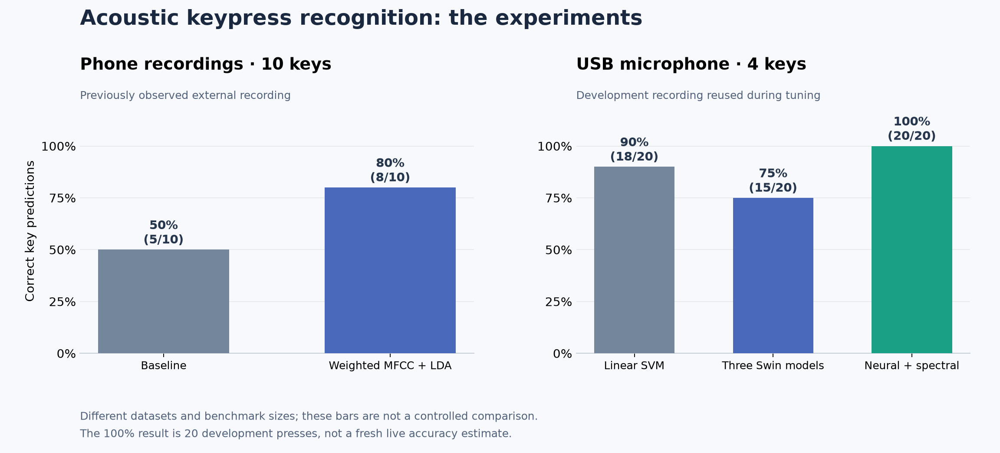

# Experiment scripts

These are two snapshots of an exploratory acoustic keystroke project. I wanted to play around with recognizing keys from their sound, collect my own recordings, and see what worked. The project does not claim a new attack or a new machine learning method.

| Directory | Recording setup and labels | Models | Guide |
| --- | --- | --- | --- |
| `1_numpad/` | Phone recordings; numpad 0–9; 251 clips | MFCC features with a small classifier search | [Dataset 1 guide](1_numpad/README.md) |
| `2_numpad/` | LCS USB microphone recordings; numpad 0–3; 706 clips | Classic SVM, three Swin transformers, and a neural/spectral hybrid | [Dataset 2 guide](2_numpad/README.md) |

The experiments use different class counts and evaluation sets. Dataset 2's 20-event recording was reused during development; its final 100% score is not a fresh estimate of live accuracy. See the [results guide](../results/README.md) for the denominators and protocols.

Each experiment keeps the same numbered entry points:

| Script | Purpose |
| --- | --- |
| `0_visualize.py` | Plot RMS energy, detected peaks, thresholds, and percentiles |
| `1_keypresses.py` | Split original recordings at quiet gaps and write provenance manifests |
| `2_train.py` | Train a model and save local reports |
| `3_predict.py` | Classify one isolated keypress file |
| `4_evaluate.py` | Score a frozen model against labeled sequence clips |
| `5_live_predict.py` | Listen to a microphone or replay a recording through the streaming detector |

The two directories intentionally preserve their experiment-specific detector, frontend, and training choices. Supporting modules implement shared behavior within each experiment; `test_*.py` files sit next to the modules they exercise. Run each test suite separately because the two experiments use the same module names.

Default dataset and output paths resolve relative to the repository, so they work regardless of the current working directory. The commands in these guides assume the repository root and an activated virtual environment. Use `--help` on an entry point for its full option list.

Recordings and split clips are under [`datasets/`](../datasets/README.md). Selected historical metrics, predictions, and figures are under [`results/`](../results/README.md). Scripts generate new outputs under `work/`; trained model files, caches, and checkpoints stay local and are excluded from Git. Train a model before running file prediction, frozen evaluation, or live prediction in a fresh clone.
